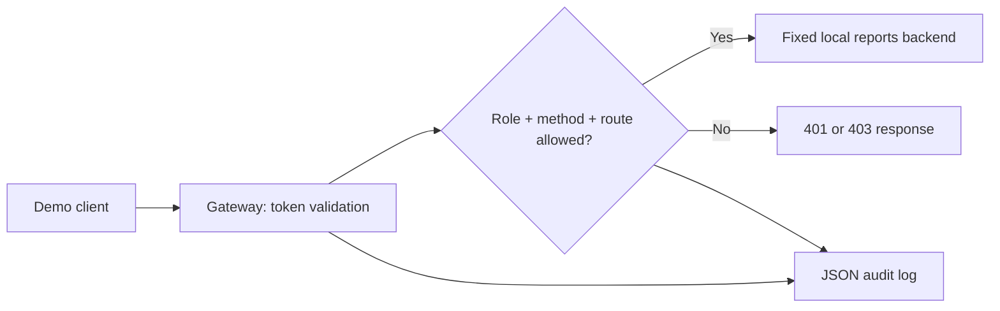

# PolicyGate

A Python/FastAPI application-access gateway with signed-token validation, role-based route policies, controlled upstream forwarding, and structured authorization logs.

## What it demonstrates

- Authentication with HS256 JWTs: signature, expiration, issuer, audience, subject, and role validation using PyJWT.
- Explicit reader/admin permissions; unlisted routes and methods are denied.
- A fixed loopback upstream, no user-selected destination, no upstream redirect following, and no forwarding of client credentials.
- Bounded JSON report creation and predictable upstream error responses.
- Server-generated request IDs and JSON decision logs that omit credentials and request bodies.
- Automated tests and a demo that starts two real HTTP servers locally.



## Permission matrix

| Request | Missing/invalid token | Reader | Admin |
|---|---:|---:|---:|
| `GET /health` | 200 | 200 | 200 |
| `GET /reports` | 401 | 200 | 200 |
| `POST /reports` with a valid body | 401 | 403 | 201 |
| Any other path or method | 401 | 403 | 403 |

`/health` reports gateway liveness, not upstream readiness. Authentication is evaluated before authorization. The upstream is a synthetic in-memory report service; its data resets on restart.

## Quick start

Use Python 3.11 or newer. Run the following from the repository directory. Creating a virtual environment keeps the dependencies separate from other projects.

### Windows PowerShell

```powershell
python -m venv .venv
.\.venv\Scripts\python.exe -m pip install -r requirements-lock.txt
.\.venv\Scripts\python.exe -m pytest -q
.\.venv\Scripts\python.exe scripts/demo.py
```

### macOS/Linux

```bash
python3 -m venv .venv
.venv/bin/python -m pip install -r requirements-lock.txt
.venv/bin/python -m pytest -q
.venv/bin/python scripts/demo.py
```

The demo generates a temporary signing secret in memory, chooses two loopback ports, runs the backend and gateway, checks response statuses, and stops both processes. It does not print the secret or tokens. Tests use synthetic credentials and data only.

`requirements-lock.txt` records the full tested environment, including development dependencies. `requirements.txt` lists direct runtime dependencies; `requirements-dev.txt` adds the test runner for deliberate dependency updates.

## Run the services manually

Terminal 1, from the repository directory:

```powershell
.\.venv\Scripts\python.exe -m uvicorn policygate.upstream:app --host 127.0.0.1 --port 8001 --no-access-log
```

Terminal 2, from the same directory:

```powershell
$env:POLICYGATE_SECRET = (.\.venv\Scripts\python.exe -c "import secrets; print(secrets.token_hex(32))")
$env:POLICYGATE_UPSTREAM_URL = 'http://127.0.0.1:8001'
$readerToken = (.\.venv\Scripts\python.exe -m policygate.issue_token --role reader --subject demo-reader)
$adminToken = (.\.venv\Scripts\python.exe -m policygate.issue_token --role admin --subject demo-admin)
.\.venv\Scripts\python.exe -m uvicorn policygate.gateway:app_from_env --factory --host 127.0.0.1 --port 8000 --no-access-log
```

Generate and use tokens from a shell sharing the same secret as the gateway. The automated demo avoids manual token transfer between terminals. Tokens last five minutes by default. The CLI is an offline demo issuer: access to the signing secret lets its holder mint any supported role. There is deliberately no public token-issuance endpoint.

Disable Uvicorn's access log as shown above: ordinary web access logs can include query strings. The application's audit logger records a limited set of metadata instead. Avoid putting sensitive information in URLs or token claims; signed JWT contents are not encrypted.

## Project map

- `policygate/config.py`: validates settings and fixed upstream configuration.
- `policygate/auth.py`: validates tokens and identity claims.
- `policygate/gateway.py`: permission checks, request validation, forwarding, and audit events.
- `policygate/upstream.py`: toy report storage and endpoints.
- `policygate/issue_token.py`: local token CLI.
- `tests/`: authentication, authorization, forwarding, error, and logging checks.
- `scripts/demo.py`: reproducible live HTTP walkthrough.
- `docs/VALIDATION.md`: recorded test environment and actual results.

## Scope and limitations

- Bind both servers to loopback. The toy backend is directly reachable by local processes and has no independent authentication, so this demo does not enforce a production network isolation boundary. A real deployment would need authenticated service-to-service traffic and restricted upstream reachability.
- One static policy, two roles, a local symmetric signing key, and short-lived tokens. No login service, SSO, key rotation, token revocation, device posture, or continuous risk evaluation.
- The report store is in memory. No database, persistence, tenant isolation, distributed rate limiting, or multi-worker consistency claim.
- This is not a general HTTP proxy: no arbitrary destinations, streaming downloads, file uploads, WebSockets, or pass-through client headers.
- Transport uses loopback HTTP for learning. No TLS termination is implemented. Do not expose the demo publicly as-is.
- Tests show specific checked behaviors. No independent security audit, penetration-test certification, production deployment, or performance target is claimed.

## References

- [FastAPI security tutorial](https://fastapi.tiangolo.com/tutorial/security/oauth2-jwt/)
- [PyJWT validation documentation](https://pyjwt.readthedocs.io/en/stable/usage.html)
- [HTTPX transports for testing](https://www.python-httpx.org/advanced/transports/)

The implementation uses these libraries rather than implementing cryptography. Preserve attribution when extending the project.
